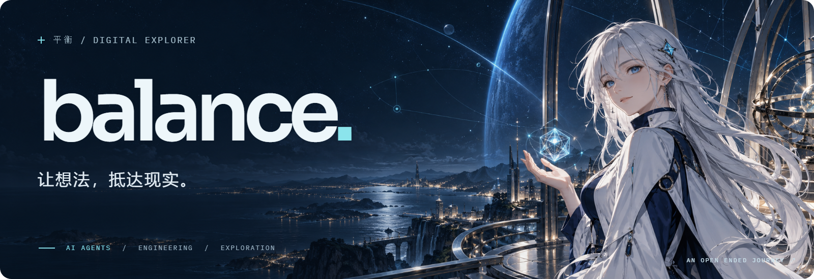
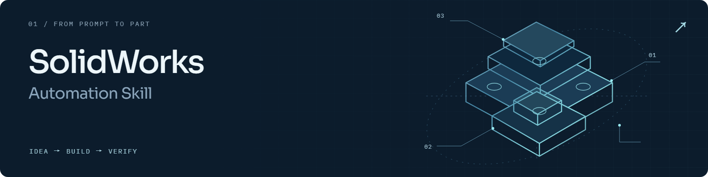
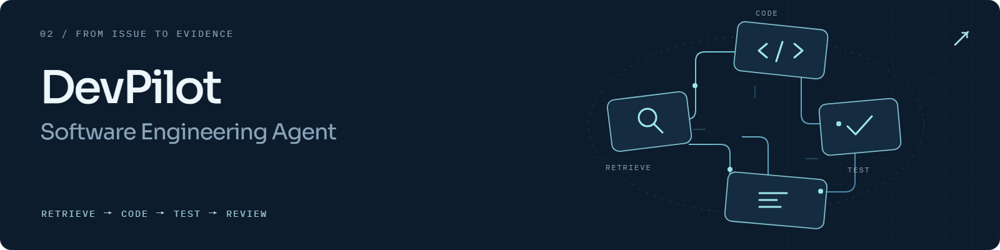
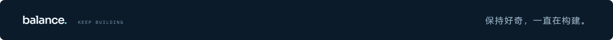

<picture>
  <source media="(max-width: 600px)" srcset="./assets/hero-mobile.png">
  
</picture>

  <a href="#about">关于我</a> &nbsp; / &nbsp;
  <a href="#work">代表作品</a> &nbsp; / &nbsp;
  <a href="#contact">保持联系 ↗</a>

### 在代码与现实之间，保持好奇。

我是 **平衡 / balance.**，构建 AI Agent，也折腾真实硬件。关注 **Agent 工具、CAD 自动化与研发流程**，把想法变成能运行、可验证的产物。

<picture>
  <source media="(prefers-reduced-motion: reduce)" srcset="./assets/signal.png">
  
</picture>

## 关于我

**让 Agent 走进真实工程。** 从理解需求、调用工具，到验证产物，我更在意一条完整链路能否可靠地工作。

- **正在构建** · SolidWorks 自动化工具与 DevPilot 研发 Agent。
- **常用工具** · Python、TypeScript、MCP、RAG、Docker，以及嵌入式开发工具。
- **代码之外** · 马拉松、DIY 与游戏。

## 代表作品

<a href="https://github.com/wzyn20051216/solidworks-automation-skill">
  <picture>
    <source media="(max-width: 600px)" srcset="./assets/solidworks-mobile.png">
    
  </picture>
</a>

### [SolidWorks Automation Skill ↗](https://github.com/wzyn20051216/solidworks-automation-skill)

连接 AI Agent 与桌面 CAD。用 **Skill + MCP + 执行核心**组织建模能力，让工具调用有结果，让任务完成有证据。

`Python` · `MCP` · `COM / .NET` · `CAD`

 

<a href="https://github.com/wzyn20051216/DevPilot">
  <picture>
    <source media="(max-width: 600px)" srcset="./assets/devpilot-mobile.png">
    
  </picture>
</a>

### [DevPilot ↗](https://github.com/wzyn20051216/DevPilot)

面向真实代码仓库的研发 Agent。结合 **混合检索、受控工具与隔离测试**，把需求推进为可审查的修改。

`Python` · `TypeScript` · `RAG` · `Docker`

 

**其他探索 · MindBridge**  
多 Agent 协作、共享任务板、分层记忆与独立安全审查。持续探索自主执行与可靠边界之间的平衡。

## 保持联系

欢迎交流 Agent、CAD 自动化、嵌入式与有意思的工程想法。

**[给我写信 ↗](mailto:lly9259@outlook.com)** &nbsp; · &nbsp; **[浏览全部仓库 ↗](https://github.com/wzyn20051216?tab=repositories)**

 

<picture>
  <source media="(max-width: 600px)" srcset="./assets/signature-mobile.png">
  
</picture>
